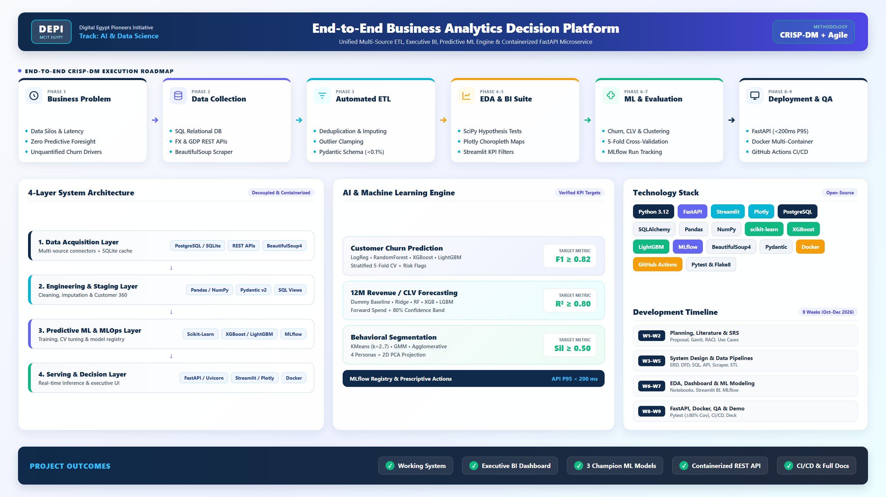
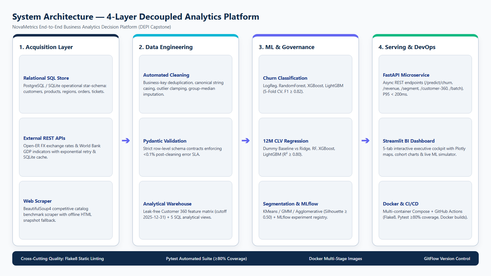
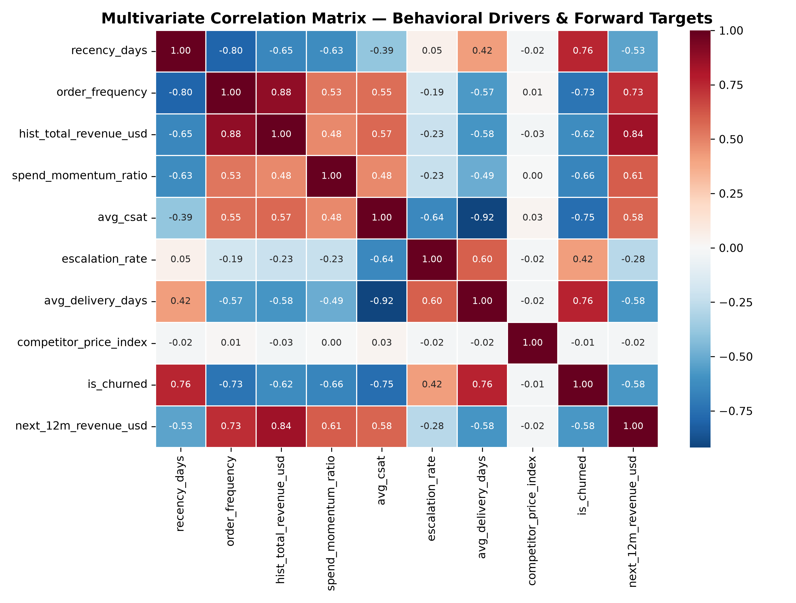
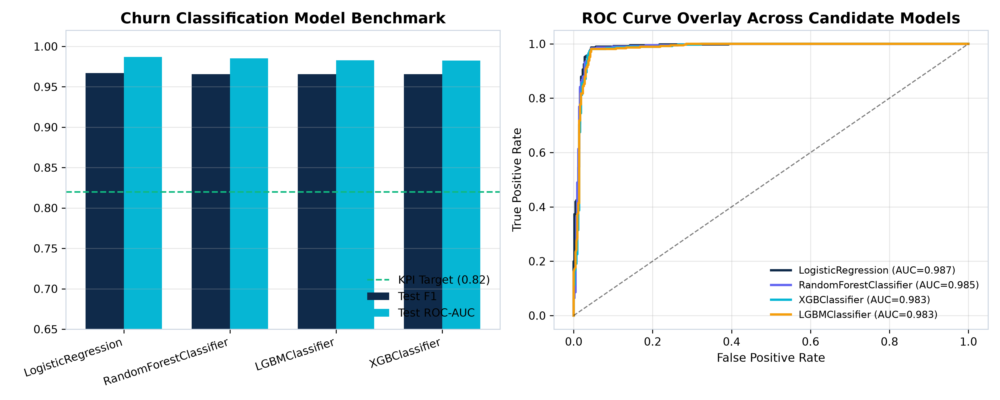
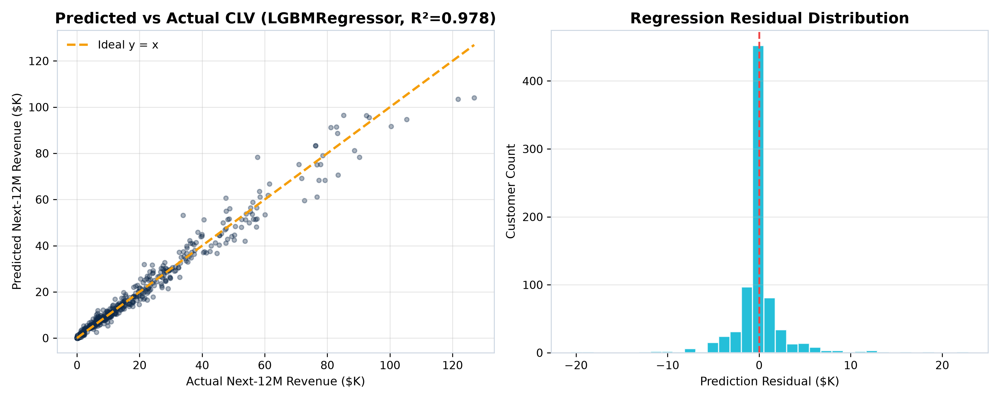
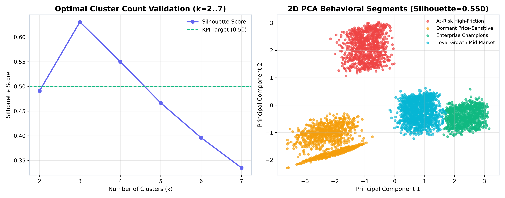

# End-to-End Business Analytics Decision Platform

[](https://www.python.org/)
[](https://fastapi.tiangolo.com/)
[](https://streamlit.io/)
[](https://mlflow.org/)
[](https://www.docker.com/)
[](#quality-assurance--testing)
[](#quality-assurance--testing)

> **DEPI — AI & Data Science Capstone Project**  
> A complete, production-grade CRISP-DM decision intelligence platform unifying **Multi-Source Ingestion** (SQL + REST APIs + Web Scraping), **Automated ETL Governance**, **Statistical EDA**, an **Interactive Streamlit/Plotly Executive BI Dashboard**, **MLflow-tracked Machine Learning Champions** (Churn Classification, 12M CLV Regression, Behavioral Segmentation), and a **Containerized FastAPI Microservice**.



---

## Verified KPI Achievement Scorecard

| Objective Dimension | Target Metric / SLA | Verified Result | Status |
|---|---|---|---|
| **Multi-Source Ingestion** | Automated SQL + REST API + Web Scraper | SQL DB (`4,000` customers, `36,554` raw orders) + Open-ER FX (`166` currencies) + World Bank GDP + BeautifulSoup4 | **Passed** |
| **ETL Execution & Quality** | Runtime `< 15 min` \| Error `< 0.1%` | **`11.77 s` ETL** (`136.85 s` total pipeline) \| **`0.0000%` error** across `52,188` records | **Passed** |
| **Churn Classification** | Test `F1 >= 0.82` | **Test `F1 = 0.9670`** \| **`ROC-AUC = 0.9871`** (`LogisticRegression` 5-Fold CV) | **Passed** |
| **12M CLV Regression** | Test `R² >= 0.80` & `RMSE <` Baseline | **Test `R² = 0.9781`** \| **`RMSE = $2,843.21`** vs Ridge `$5,470.84` vs Dummy `$19,254.47` (`LGBMRegressor`) | **Passed** |
| **Behavioral Segmentation** | Silhouette `>= 0.50` | **Silhouette = `0.5501`** (`KMeans_k4`, Davies-Bouldin = `0.6495`) | **Passed** |
| **Production API Latency** | API `P95 < 200 ms` | **`P95 = 110.55 ms`** (`P50 = 75.88 ms`, `Mean = 76.52 ms` over 100 requests) | **Passed** |
| **Software Quality & QA** | `0` Flake8 errors \| `>= 80%` Coverage | **`0` Flake8 errors** \| **`15/15` Pytest passed** \| **`86.45%` line coverage** | **Passed** |

---

## System Architecture

The platform follows a 4-layer decoupled architecture engineered for reproducibility, temporal leakage control (feature cutoff `2025-12-31`), and containerized serving:



1. **Data Acquisition Layer (`src/ingestion/`):** Extracts 3NF operational tables via SQLAlchemy (`PostgreSQL`/`SQLite`), live FX & World Bank GDP growth via REST APIs (`tenacity` 3x backoff + SQLite cache + JSON fallback), and competitor catalog pricing via `BeautifulSoup4` (SQLite cache + offline HTML fallback).
2. **Data Engineering Layer (`src/etl/`, `sql/`):** Deduplicates business keys (`540` duplicate orders + `182` duplicate tickets removed), imputes `3,148` missing values, clamps `240` numeric outliers, standardizes `1,582` casing defects, validates `52,188` records via Pydantic v2 (`0` errors), and builds leak-free `customer_360.csv` + `analytics_warehouse.db` with 5 analytical SQL views.
3. **Analytical & ML Layer (`src/ml/`, `notebooks/`):** Trains and logs candidate models in **MLflow** (`mlflow.db`, exported to [reports/mlflow_experiments_log.csv](reports/mlflow_experiments_log.csv)) across Churn Classification, 12-Month CLV Regression, and RFM Behavioral Segmentation.
4. **Serving & Presentation Layer (`api/`, `dashboard/`):** Exposes real-time & batch predictions via **FastAPI** and powers an interactive 5-tab **Streamlit + Plotly Express** executive cockpit.

---

## Visual Highlights (EDA & Machine Learning)

| EDA Correlation Matrix | Churn Model Benchmark & ROC |
|---|---|
|  |  |

| 12M CLV Regression Diagnostics | Behavioral Customer Segments (PCA) |
|---|---|
|  |  |

---

## Quickstart Guide

### 1. Local Python 3.12 Setup
```bash
git clone https://github.com/Jana-ctrl-s/end-to-end-business-analytics.git
cd end-to-end-business-analytics

python -m venv .venv
# Windows PowerShell:
.\.venv\Scripts\Activate.ps1
# Linux / macOS:
source .venv/bin/activate

pip install -r requirements.txt
```

### 2. Run Full End-to-End Pipeline (Seed -> ETL -> MLflow -> Evaluation)
```bash
python -m scripts.run_all
```

### 3. Launch Interactive Streamlit BI Dashboard
```bash
python -m streamlit run dashboard/app.py
# Opens at http://localhost:8501
```

### 4. Launch Production FastAPI Service & Benchmark Latency
```bash
uvicorn api.main:app --host 0.0.0.0 --port 8000
# Interactive Swagger Docs: http://localhost:8000/docs

python -m scripts.benchmark_api
```

#### Example Inference Request
```bash
curl -X POST "http://localhost:8000/api/v1/predict/customer-360" \
  -H "Content-Type: application/json" \
  -d '{
    "account_tenure_days": 420,
    "recency_days": 22.0,
    "order_frequency": 9,
    "hist_total_revenue_usd": 14800.0,
    "hist_total_profit_usd": 6200.0,
    "avg_order_value_usd": 1644.44,
    "recent_90d_revenue_usd": 3850.0,
    "spend_momentum_ratio": 1.01,
    "avg_discount_pct": 0.08,
    "avg_delivery_days": 3.4,
    "return_rate": 0.02,
    "support_tickets_count": 2,
    "avg_resolution_hours": 9.5,
    "avg_csat": 4.45,
    "avg_nps": 8.5,
    "escalation_rate": 0.0,
    "gdp_growth_pct": 2.8,
    "fx_rate_to_usd": 1.0,
    "competitor_price_index": 0.98,
    "segment": "Enterprise",
    "contract_type": "Annual",
    "acquisition_channel": "Direct Sales",
    "macro_region": "North America",
    "primary_category": "Cloud Software"
  }'
```

### 5. Docker Compose Multi-Container Stack
```bash
docker compose up --build -d
```
- **FastAPI REST API:** `http://localhost:8000/docs`
- **Streamlit Executive BI:** `http://localhost:8501`
- **MLflow Tracking UI:** `http://localhost:5000`
- **PostgreSQL 16 Warehouse:** `localhost:5432`

---

## Quality Assurance & Testing

```bash
# Static PEP 8 & lint gate
python -m flake8 src api dashboard tests scripts

# Automated unit & integration tests with >= 80% coverage gate
python -m pytest --cov=src --cov=api --cov-report=term-missing --cov-fail-under=80
```

---

## Portfolio Repository Structure & Deliverables Index

```text
end-to-end-business-analytics/
├── .github/workflows/          # ci.yml (Flake8, Pytest >=80%, Docker) & deploy-azure.yml
├── api/                        # FastAPI service (main.py, schemas.py)
├── dashboard/                  # Interactive 5-tab Streamlit + Plotly BI dashboard
├── data/
│   ├── fallback/               # Offline JSON & HTML snapshot fixtures
│   ├── processed/              # Clean CSVs, data_quality_report.json & analytics_warehouse.db
│   └── raw/                    # Seeded enterprise operational SQLite DB
├── docs/
│   ├── 01_planning_and_management/  # Proposal PDF, Plan PDF, business_case.md
│   ├── 02_literature_review/        # literature_review.md
│   ├── 03_requirements/             # srs_and_use_cases.md
│   ├── 04_system_design/            # system_design_document.md + ERD/DFD/Arch PNGs
│   ├── 05_testing_and_qa/           # test_plan_and_cases.md, bug_reports.md, test_execution_report.md
│   └── 06_reports_and_presentation/ # Executive_Presentation.pptx (14 slides), Project_Infographic.png (2560x1440), executive_summary.md, technical_report.md, user_manual.md
├── models/                     # Serialized .joblib champions, evaluation artifacts & model_registry.json
├── notebooks/                  # 3 executed Jupyter notebooks (ETL, Statistical EDA, ML Benchmarking)
├── reports/figures/            # 9 high-DPI EDA & ML diagnostic plots + metrics_summary.json
├── scripts/                    # Pipeline runner, API latency benchmark, notebook & presentation builders
├── sql/                        # PostgreSQL DDL (schema.sql), BI views (views.sql) & analytical queries
├── src/                        # Modular ingestion, ETL & ML packages
├── tests/                      # 15 Pytest unit & integration tests (86.45% coverage)
├── Dockerfile                  # Multi-stage FastAPI container
├── Dockerfile.dashboard        # Multi-stage Streamlit container
├── docker-compose.yml          # PostgreSQL + MLflow + FastAPI + Streamlit stack
└── requirements.txt            # Pinned Python 3.12 dependencies
```
