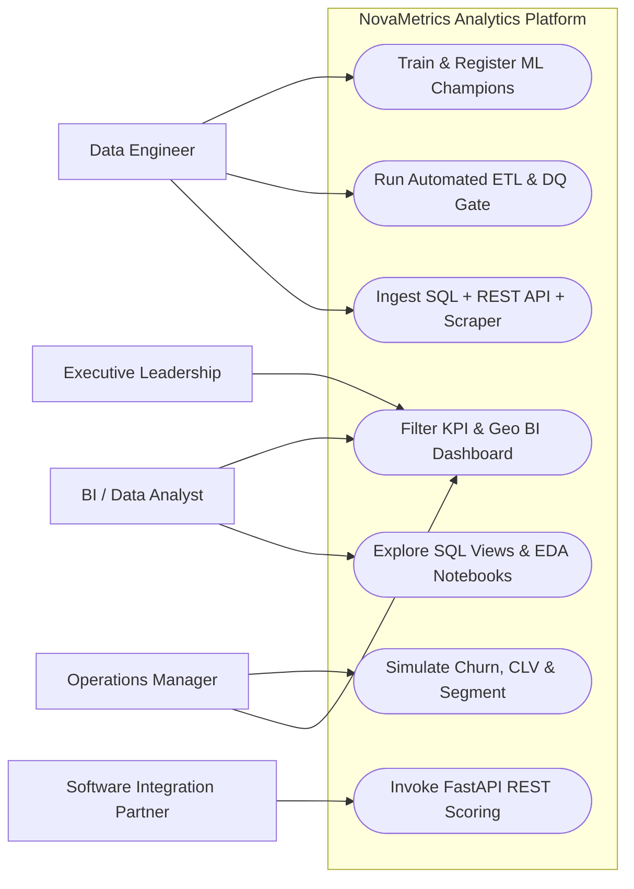
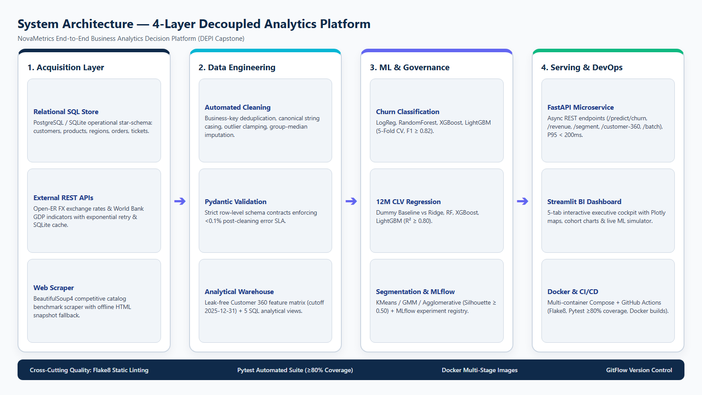
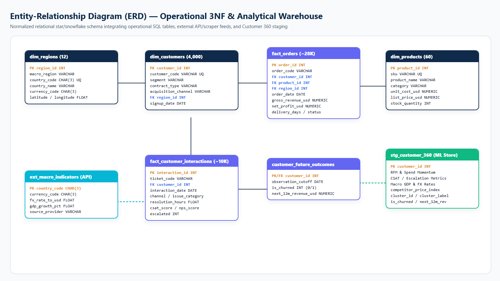
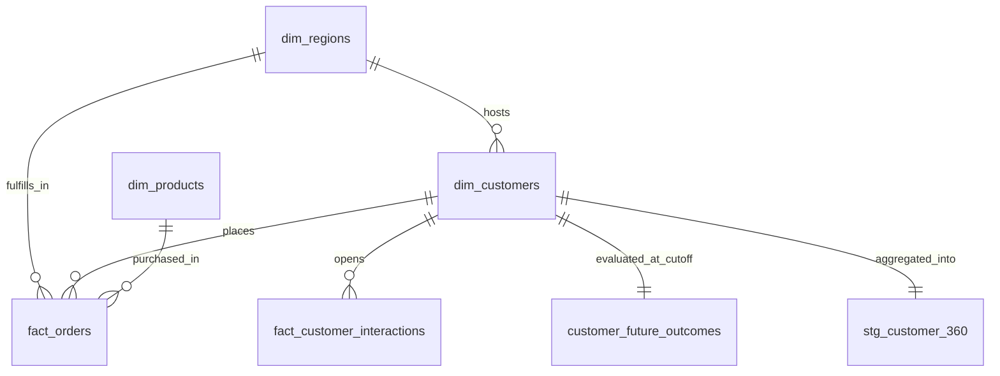
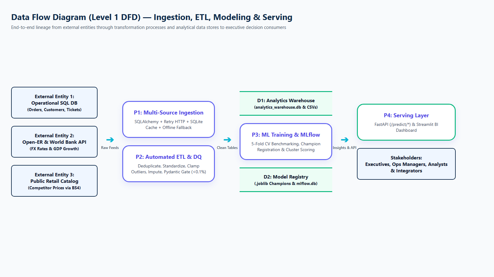
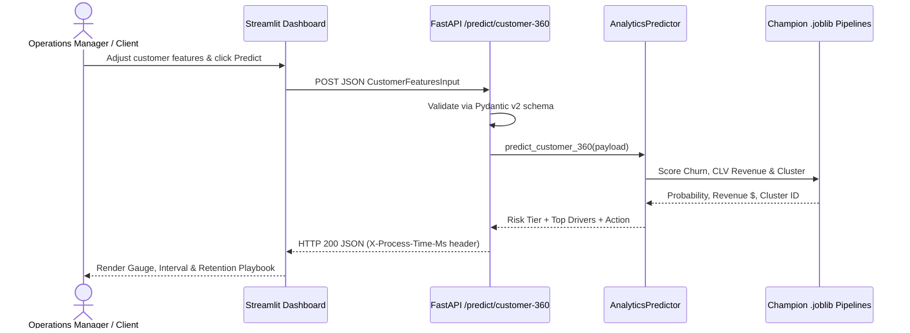
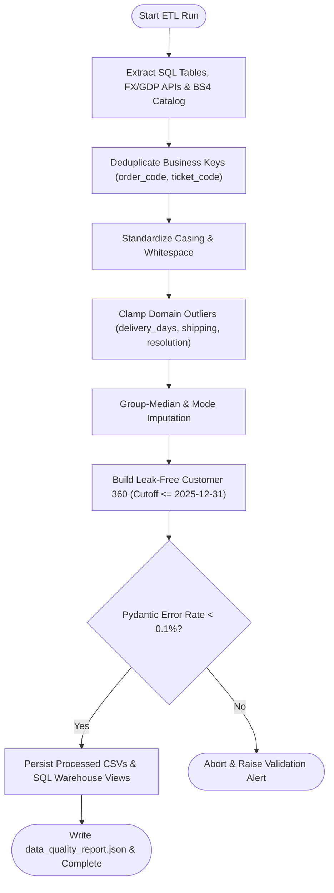
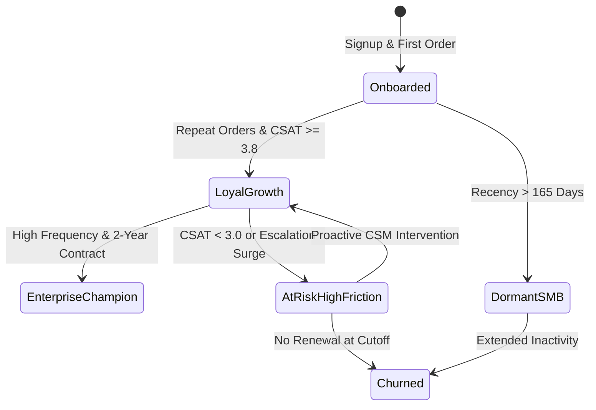
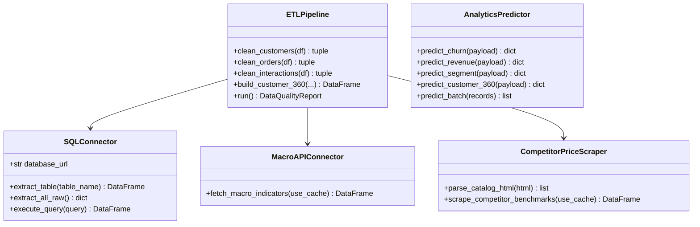
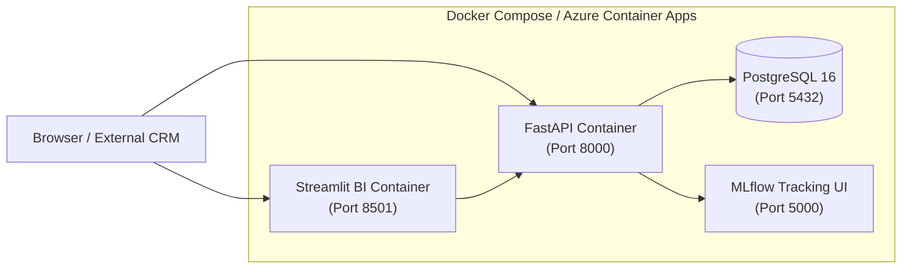

# System Design Document (SDD)

**Project:** End-to-End Business Analytics Decision Platform (*NovaMetrics Commerce*)  
**DEPI Milestone:** M4 — System Analysis & Design  

---

## 1. Problem Statement, Objectives & Use Case Model

Commercial operations suffer from siloed relational transactions, disconnected external market signals, and lack of predictive churn/revenue visibility. The platform unifies multi-source ingestion, automated ETL governance, interactive BI visualization, and containerized ML scoring.

### 1.1 Use Case Diagram



### 1.2 Software Architecture Style
The platform follows a **4-Layer Decoupled Microservice + Analytical Warehouse Architecture**:
1. **Data Acquisition Layer:** Connector abstraction (`SQLConnector`, `MacroAPIConnector`, `CompetitorPriceScraper`).
2. **Data Engineering & Transformation Layer:** Pure-Python + Pandas ETL pipeline (`ETLPipeline`) with Pydantic v2 contract enforcement and SQL warehouse staging.
3. **Analytical & Predictive ML Layer:** Scikit-Learn Pipelines + XGBoost + LightGBM tracked via MLflow (`train.py`, `evaluate.py`, `predict.py`).
4. **Serving & Presentation Layer:** Asynchronous **FastAPI** inference microservice paired with a reactive **Streamlit + Plotly** executive dashboard.



---

## 2. Database Design & Data Modeling

### 2.1 Entity-Relationship Diagram (ERD)





### 2.2 Logical & Physical Schema & Normalization
- **3NF Operational Layer (`sql/schema.sql`):** `dim_regions`, `dim_products`, `dim_customers`, `fact_orders`, `fact_customer_interactions`, `customer_future_outcomes`. Eliminates transitive dependencies on region currency/coordinates and product SKU metadata.
- **External Enrichment Tables:** `ext_macro_indicators` (country PK) and `ext_competitor_benchmarks` (category PK).
- **Analytical Denormalized Staging:** `stg_orders_clean` and `stg_customer_360` plus 5 pre-indexed BI views (`sql/views.sql`) optimize read performance for Streamlit and ad-hoc SQL reporting.

---

## 3. Data Flow & System Behavior

### 3.1 Context & Level-1 Data Flow Diagram (DFD)



### 3.2 Sequence Diagram — Real-Time Decision Prediction



### 3.3 Activity Diagram — Automated ETL & Quality Gate



### 3.4 State Diagram — Customer Account Lifecycle



### 3.5 Class Diagram — Core Python Architecture



---

## 4. UI/UX Design & Prototyping

### 4.1 Wireframe Layout (Streamlit Executive BI Cockpit)
```
+-----------------------------------------------------------------------------+
| [HEADER] NovaMetrics Enterprise Decision Intelligence Platform               |
+---------------+-------------------------------------------------------------+
| SIDEBAR       | [Tabs]: Executive KPIs | Geo & Market | Churn & Segments |  |
| - Date Range  |         Live ML Simulator | ML Governance & DQ               |
| - Region      +-------------------------------------------------------------+
| - Segment     | [KPI 1]   [KPI 2]   [KPI 3]   [KPI 4]   [KPI 5]   [KPI 6]   |
| - Category    +------------------------------+------------------------------+
|               | Monthly Revenue & Profit     | Category Margin Bar Chart    |
|               | Trend + 3M Moving Average    | (Plotly Horizontal Bar)      |
+---------------+------------------------------+------------------------------+
```

### 4.2 UI/UX Design Guidelines
- **Color Palette:** Deep Blue (`#0F2A4A`) primary headers, Indigo/Purple (`#6366F1`) secondary accents, Cyan (`#06B6D4`) analytical highlights, Amber (`#F59E0B`) caution/trends, Emerald (`#10B981`) positive KPIs, Coral (`#EF4444`) churn alerts on a crisp `#F8FAFC` light surface.
- **Typography & Accessibility:** Clean sans-serif hierarchy, clear KPI deltas, hover tooltips on all Plotly visualizations, and CSV export buttons for operational follow-through.

---

## 5. System Deployment, Integration & API Specification

### 5.1 Technology Stack
- **Backend / ML:** Python 3.12, Pandas, NumPy, SciPy, Scikit-Learn, XGBoost, LightGBM, MLflow, Joblib, Pydantic v2.
- **Database & Scraping:** SQLAlchemy 2.0, PostgreSQL 16 / SQLite, Requests, BeautifulSoup4, Tenacity.
- **Serving & Frontend:** FastAPI, Uvicorn, Streamlit, Plotly Express, Matplotlib, Seaborn.
- **DevOps & Quality:** Docker, Docker Compose, GitHub Actions, Pytest, Coverage.py, Flake8.

### 5.2 Deployment & Component Diagram



### 5.3 REST API Endpoint Summary
| Method | Path | Request Schema | Response Schema | Purpose |
|---|---|---|---|---|
| `GET` | `/health` | — | `HealthResponse` | Liveness & model readiness probe |
| `GET` | `/api/v1/models/metadata` | — | `ModelMetadataResponse` | Champion identifiers & benchmark scores |
| `POST` | `/api/v1/predict/churn` | `CustomerFeaturesInput` | `ChurnPredictionResponse` | Churn probability & risk tier |
| `POST` | `/api/v1/predict/revenue` | `CustomerFeaturesInput` | `RevenuePredictionResponse` | 12M CLV forecast + 80% interval |
| `POST` | `/api/v1/predict/segment` | `CustomerFeaturesInput` | `SegmentPredictionResponse` | Behavioral persona assignment |
| `POST` | `/api/v1/predict/customer-360` | `CustomerFeaturesInput` | `Customer360Response` | Combined prediction + action playbook |
| `POST` | `/api/v1/predict/batch` | `BatchPredictionRequest` | `BatchPredictionResponse` | Vectorized scoring up to 500 records |

### 5.4 Scaling & Deployment Strategy
- Stateless FastAPI workers scale horizontally behind a load balancer (e.g., Azure Container Apps replicas), loading serialized `.joblib` champions once during ASGI lifespan startup for sub-20ms per-request execution.
- Scheduled batch ETL runs update PostgreSQL staging tables and trigger conditional model retraining tracked in MLflow.
